# ForgeOps-AI


ForgeOps-AI is a full-stack DevOps decision-support platform for infrastructure-as-code generation, log analysis, and shell-command safety review. It provides reviewable recommendations; it does not autonomously run AI-generated commands or deploy infrastructure.

**Live EC2 demo:** [Open ForgeOps](http://ec2-3-111-42-136.ap-south-1.compute.amazonaws.com:3000/login) (sign-in required). Checked on 22 October 2026: the branded frontend, Spring Boot API, PostgreSQL, and Redis were healthy. The demo uses the local DevOps rules engine because Gemini is not configured. The current public endpoint is HTTP; do not enter a personal password or secret. The deployed backend is an earlier release, so the Operations and Audit features in the newer source tree are not available in this live demo. See the [recording runbook](docs/DEMO_RUNBOOK.md) for verified workflows and limitations.

## Overview

ForgeOps-AI serves as an operational workspace for DevOps and Platform Engineering teams. It accepts pasted logs and workload events for incident diagnosis, generates reviewable pipeline and infrastructure templates, and assesses shell-command risk before an operator acts. The dashboard displays backend-reported health snapshots and saved activity. The Spring Boot backend can use Gemini when configured; otherwise, local rules provide responses.

Intended users include DevOps engineers, system administrators, and site reliability engineers (SREs).

The screenshots below are original captures of the application, CI pipeline, and demo deployment.

## Contents

- [Capabilities](#capabilities)
- [Architecture](#system-architecture)
- [Product tour](#product-tour)
- [Recording runbook](docs/DEMO_RUNBOOK.md)
- [Local setup](#local-setup)
- [Validation](#validation)
- [Delivery and deployment](#delivery-and-deployment)
- [Security](#security)

## Capabilities

| Area | Live EC2 demo | Newer source tree |
| --- | --- | --- |
| Infrastructure generation | Reviewable Terraform, Kubernetes, Helm, Dockerfile, GitHub Actions, and GitLab CI templates. | Same workflow, with source changes not yet deployed to EC2. |
| Incident diagnostics | Pasted CI/CD, Docker, and Kubernetes logs with saved analysis history. | Same workflow. The local analyzer can return broad diagnoses for unfamiliar logs. |
| Command safety | Risk explanation and command suggestions; ForgeOps does not execute commands. | Adds approval records and external/manual execution handoffs. |
| Governance | Authenticated accounts and server-side permissions. | Adds operation approvals, correlation IDs, and append-only audit events. These newer APIs are not working on EC2 yet. |
| Observability | Backend health and dashboard snapshots; PostgreSQL and Redis are running. | Optional Prometheus and Grafana Compose profile and metrics instrumentation. |
| Identity and access | JWT authentication and role-based access. | Rotating refresh tokens and expanded permission model. |
| Operator experience | Responsive dark workspace with the updated ForgeOps mark. | Operations and Audit pages are present but depend on the newer backend. |

## System Architecture

The live EC2 deployment serves the React SPA through Nginx on port 3000 and proxies authenticated REST requests to Spring Boot. The backend uses PostgreSQL for persisted records, Redis for caching, and a local rules engine for DevOps guidance. The code also supports an optional Gemini integration and Server-Sent Events for assistant responses. HTTPS termination and the optional Prometheus/Grafana profile are not enabled on this demo endpoint.

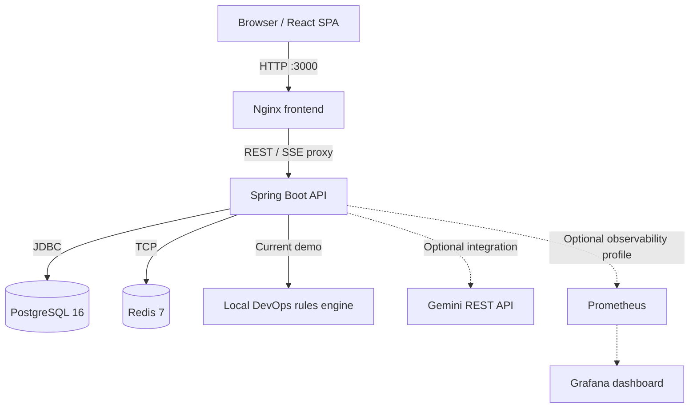

## Tech Stack

### Frontend
- React 18
- TypeScript
- Vite 8
- Tailwind CSS 4

### Backend
- Java 21
- Spring Boot 4.1
- Spring Security
- JPA / Hibernate
- Flyway

### Database & Caching
- PostgreSQL 16
- Redis 7
- HikariCP

### AI/ML
- Local DevOps rules engine (active in the EC2 demo)
- Optional Gemini REST API integration when a valid API key and model are configured

### DevOps & Infrastructure
- Docker & Docker Compose
- Kubernetes & Kustomize

### Testing
- JUnit 5 & Mockito
- Testcontainers
- Vitest
- Playwright
- k6

### Monitoring
- Prometheus
- Grafana

## Project Structure

```text
forgeOps-AI/
├── backend/                 # Spring Boot application, flyway migrations, and backend tests
├── frontend/                # React SPA, UI components, and E2E tests
├── infra/
│   ├── docker/              # Docker Compose configuration and environment templates
│   ├── k8s/                 # Kustomize base for Kubernetes deployment
│   └── observability/       # Prometheus and Grafana provisioning definitions
├── tests/
│   └── load/                # k6 load testing scripts and scenarios
├── .github/workflows/       # GitHub Actions CI/CD pipelines
└── .gitlab-ci.yml           # GitLab CI/CD pipeline definition
```

## How It Works

1. **User Authentication**: The client authenticates via the `/api/auth/login` endpoint. A short-lived JWT is held in memory, while an `HttpOnly` refresh token is stored in the browser and hashed in PostgreSQL. The cookie's `Secure` flag requires HTTPS and is off for this HTTP demo.
2. **Authorization**: Spring Security reloads the account on each JWT-authenticated request and enforces explicit permissions at controller methods. The frontend only mirrors those permissions for usability.
3. **AI processing**: The backend queries Gemini when configured and otherwise uses local rule engines. Provider output is treated as untrusted recommendation text.
4. **Execution boundary**: ForgeOps classifies command risk but never invokes a shell. The newer source tree adds an approval workflow for medium/high-risk operations and an idempotent external/manual execution handoff; these endpoints are not available in the EC2 demo yet.
5. **Traceability**: the newer source tree links recommendations, decisions, handoffs, and audit events through correlation IDs. Its Prometheus metrics can be collected when the optional observability profile is enabled.

## Product Tour

The captures below document earlier releases of the application and supporting infrastructure. The live login page now uses the [new ForgeOps mark](frontend/public/forgeops-mark-v2.svg); the screenshots have not all been recaptured since that branding update.

### Authentication and Overview

| Sign-in | Overview dashboard |
| --- | --- |
| 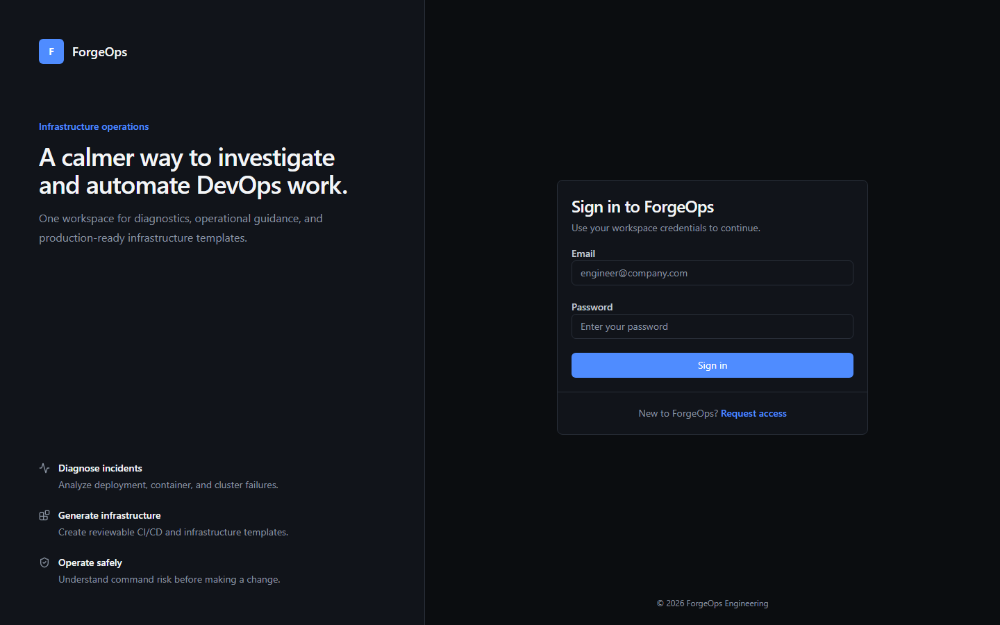 | 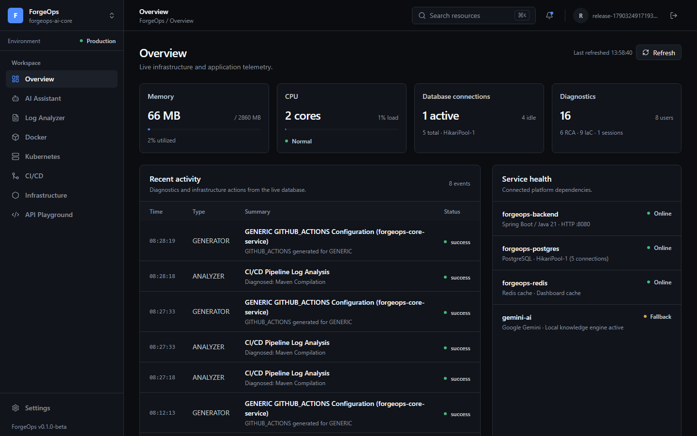 |

### Investigation and Automation

| Log analysis | Generated CI/CD pipeline |
| --- | --- |
| 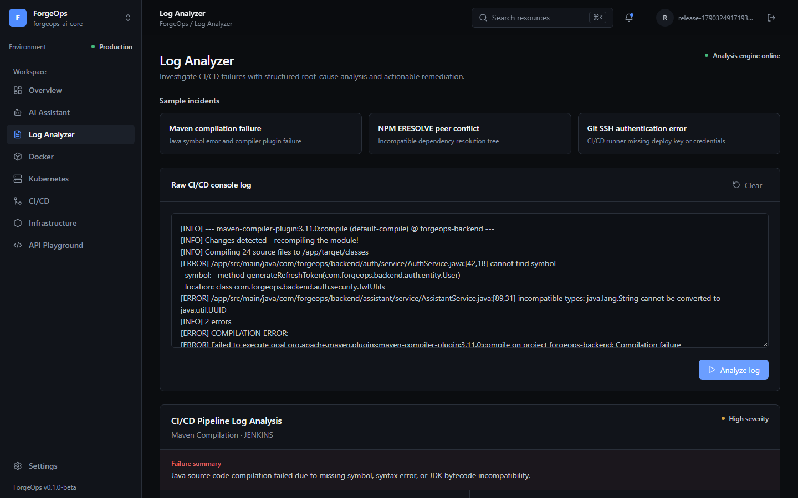 | 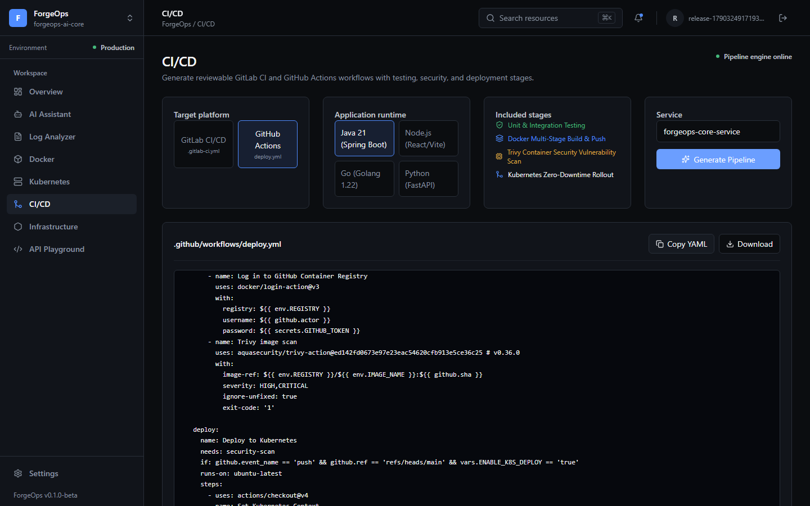 |

### Additional Interfaces

| API playground | Responsive navigation |
| --- | --- |
| 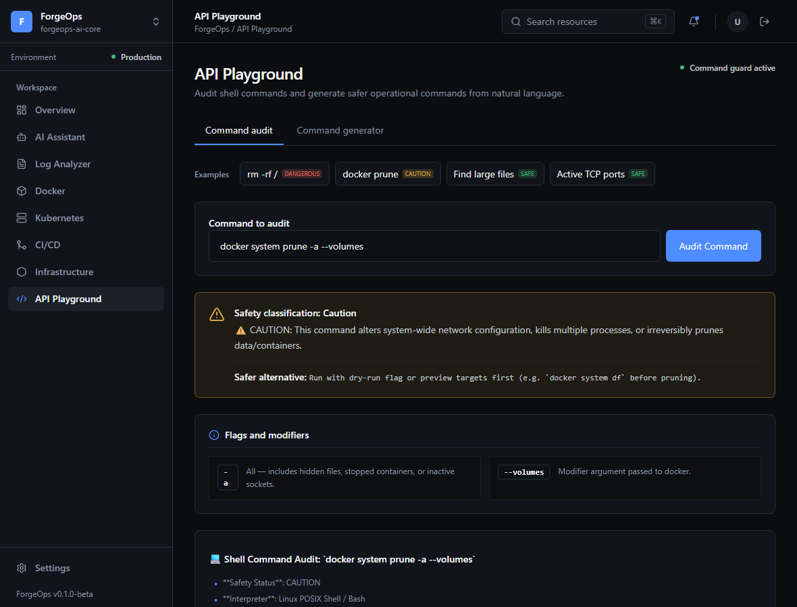 | 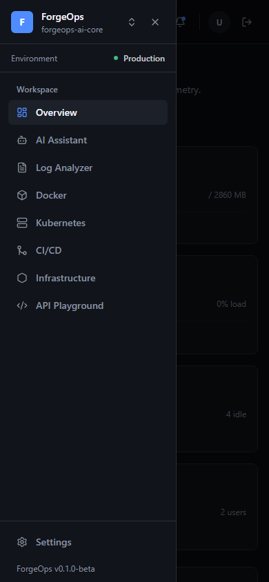 |

### Optional Observability

The optional Docker Compose `observability` profile provisions Grafana and Prometheus. This earlier capture shows Prometheus scraping the backend, including HTTP throughput and p95 latency, JVM heap, database-pool activity, uptime, threads, and CPU utilization. The profile is not part of the currently running public EC2 demo stack.

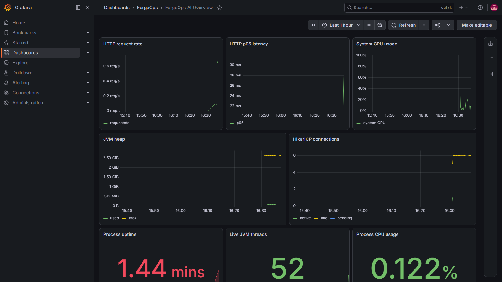

## Local Setup

### Prerequisites

- Java 21
- Maven 3.9+
- Node.js 20+
- npm
- Docker Engine & Docker Compose (for local deployment)
- PostgreSQL 16 (for bare-metal execution)

### Installation

```bash
git clone https://github.com/MayankSinghChouhann/forgeOps-AI.git
cd forgeOps-AI

# Install frontend dependencies
cd frontend
npm ci
cd ..
```

### Environment Configuration

Configuration is managed via environment variables. Create `.env` files based on the provided templates. Never commit populated `.env` files containing actual secrets.

Example configuration keys:

```env
SPRING_DATASOURCE_URL=
SPRING_DATASOURCE_USERNAME=
SPRING_DATASOURCE_PASSWORD=
FORGEOPS_JWT_SECRET=
FORGEOPS_ALLOWED_ORIGINS=
REDIS_PASSWORD=
FORGEOPS_METRICS_PASSWORD=
GRAFANA_ADMIN_PASSWORD=
GEMINI_API_KEY=
FORGEOPS_APPROVAL_TTL=24h
```

### Run Locally

#### Using Docker Compose

```bash
cp infra/docker/.env.example infra/docker/.env
# Populate infra/docker/.env with secure values
docker compose --env-file infra/docker/.env -f infra/docker/docker-compose.yml up --build -d
```

#### Bare-Metal Execution

Backend:
```bash
export SPRING_PROFILES_ACTIVE=dev
export SPRING_DATASOURCE_URL=jdbc:postgresql://localhost:5432/forgeops_db
export SPRING_DATASOURCE_USERNAME=forgeops_user
export SPRING_DATASOURCE_PASSWORD=your_password
export FORGEOPS_JWT_SECRET=your_jwt_secret
mvn -f backend/pom.xml spring-boot:run
```

Frontend:
```bash
cd frontend
cp .env.example .env.local
npm run dev
```

## Validation

### Backend Unit and Integration Tests

The backend utilizes JUnit 5 and Testcontainers for PostgreSQL integration.

```bash
mvn -f backend/pom.xml clean verify
```

### Frontend Tests

The frontend includes unit testing with Vitest and end-to-end testing with Playwright.

```bash
cd frontend
npm run typecheck
npm run lint
npm test
npx playwright install chromium
npm run test:e2e
```

### Load Testing

The k6 script defines 450 non-AI and 50 command-audit virtual users. It requires a dedicated test account; run it only against an environment prepared for load testing.

```bash
k6 run -e BASE_URL=http://localhost:8080 -e TEST_EMAIL='<test-email>' -e TEST_PASSWORD='<test-password>' tests/load/forgeops.js
```

### Build

To compile the production artifacts:

Backend:
```bash
mvn -f backend/pom.xml clean package -DskipTests
```

Frontend:
```bash
cd frontend
npm run build
```

## Delivery and Deployment

### CI/CD Pipelines

The repository includes GitHub Actions (`.github/workflows/ci.yml`) and GitLab CI (`.gitlab-ci.yml`) definitions. Pipelines enforce Trivy vulnerability scanning, ESLint validation, Playwright E2E tests, and Java unit testing prior to container publishing.

The captured GitHub Actions run below shows successful backend tests, frontend checks, repository scanning, container publishing, image scanning, and a completed deployment job. A green deployment job alone does not confirm a cluster rollout: the workflow skips its apply step when cluster credentials are absent.

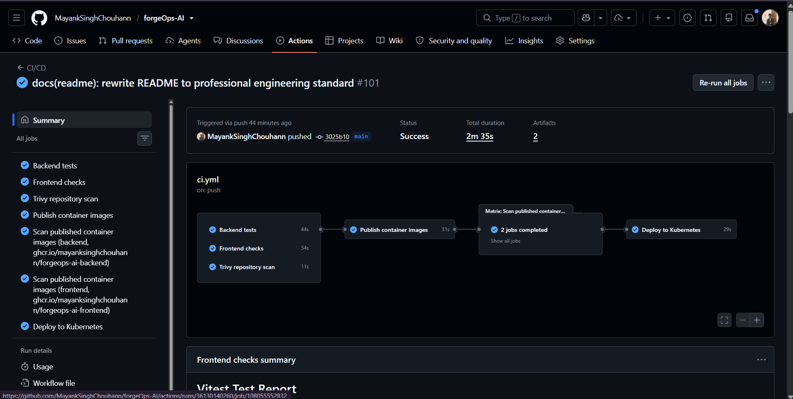

### Docker Compose

The default Compose stack runs the backend, React frontend, PostgreSQL, and Redis. Prometheus and Grafana are available through the optional `observability` profile. The status capture below was taken from an earlier running Docker Engine.

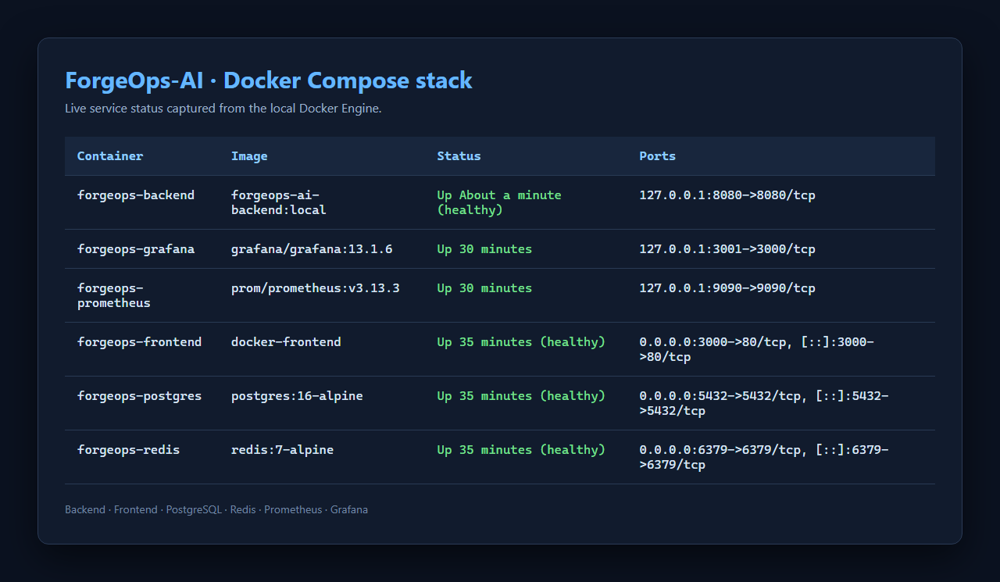

### Kubernetes

A Kustomize base is provided for Kubernetes deployment. This includes manifests for namespaces, ConfigMaps, Deployments, HorizontalPodAutoscalers (HPA), Services, PodDisruptionBudgets (PDB), NetworkPolicies, and Ingress.

```bash
kubectl apply -k infra/k8s
kubectl -n forgeops rollout status deployment/backend
kubectl -n forgeops rollout status deployment/frontend
```

*Note: For production, externalize the PostgreSQL and Redis instances to managed services and supply credentials via a Kubernetes Secret or native cloud secret manager.*

### AWS Demo Deployment

The [EC2 demo](http://ec2-3-111-42-136.ap-south-1.compute.amazonaws.com:3000/login) runs the frontend on public port 3000; the backend and PostgreSQL host ports are bound to loopback. Docker restart policies are `unless-stopped`. The new logo is included in local frontend image `forgeops-ai-frontend:logo-v2-20261022`. The images below document the original launch and Compose setup, not the current release status. The instance remains running for the recording until its owner authorizes shutdown.

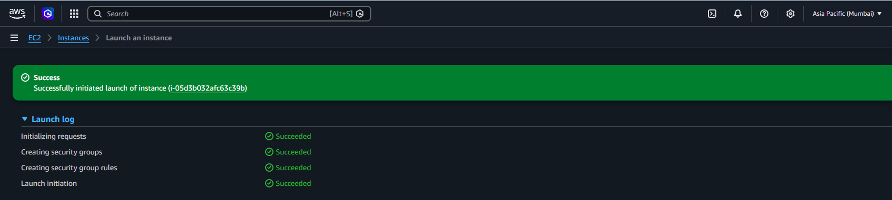
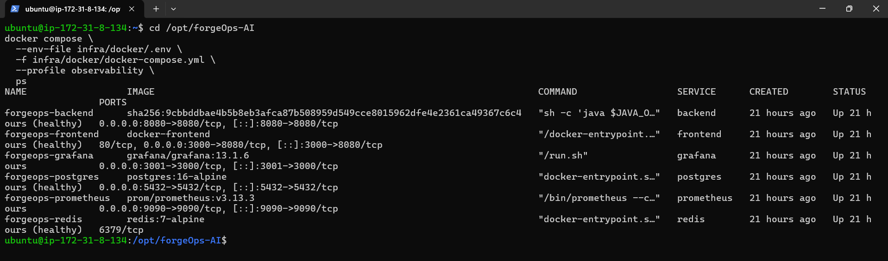

## API Documentation

The REST API documentation is generated automatically via OpenAPI in development. It is disabled by the `prod` profile.

- Swagger UI: `http://localhost:8080/swagger-ui.html`
- OpenAPI JSON: `http://localhost:8080/v3/api-docs`

## Security

This section describes controls in the current source tree. The EC2 demo runs an earlier backend release; its Operations and Audit APIs are not ready to demonstrate.

- **Authentication**: JWTs are stored in memory. Refresh tokens are persisted as SHA-256 hashes and transmitted via `HttpOnly` and `SameSite=Strict` cookies. The `Secure` cookie flag is enabled for HTTPS deployments; this HTTP-only EC2 demo configures it off.
- **Authorization**: `ADMIN`, `OPERATOR`, `APPROVER`, and `VIEWER` roles map to explicit server-side permissions. New self-registered accounts are least-privilege viewers; an administrator must grant operational access.
- **Approval separation**: requesters cannot approve their own medium/high-risk operation. Pessimistic row locking, expiry, state-transition validation, and idempotency keys prevent duplicate or replayed execution handoffs.
- **Audit**: mutating APIs and domain lifecycle events are written to a searchable audit table. Sensitive metadata keys are redacted before persistence; PostgreSQL rejects audit-row updates and deletes.
- **AI boundary**: model output is never passed to `Runtime.exec`, `ProcessBuilder`, or a shell. The execution handoff is explicitly external/manual.
- **Measured evaluation**: Micrometer records API and AI latency/errors. Database-derived metrics report acceptance/rejection, approval turnaround, execution outcomes, and execution latency; empty datasets return no value rather than invented numbers.
- **Rate Limiting**: In-process, per-IP rate limiting is applied to authentication and AI endpoints; a multi-replica deployment needs a shared or edge limiter.
- **Dependency Scanning**: Trivy is integrated into the CI/CD pipeline to block deployments of images with HIGH or CRITICAL vulnerabilities.
- **Container Hardening**: The application Docker images run as non-root users. The Kubernetes manifests additionally drop capabilities and set read-only root filesystems.

The detailed permission matrix, workflow transitions, audit model, metric names, and production limitations are documented in [Security and operations architecture](docs/SECURITY_ARCHITECTURE.md).

## License

Released under the MIT License. See the `LICENSE` file for full text.

## Authors / Maintainers

- Mayank Singh Chouhan
